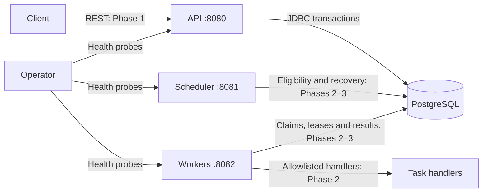

# Architecture

## Scope and context

DurableFlow will accept versioned DAG workflow definitions and execution requests, persist state, coordinate eligible tasks across workers, and recover abandoned work. PostgreSQL is the initial source of truth and coordination point. Clients communicate through a REST control plane. Task execution will be at least once.

Phase 0 implements independent process startup, shared persistence configuration, migration bootstrap and health checks. The workflow APIs, domain state machines, execution, leases and leadership described below are design intent for later phases.

## Components

- **Model:** dependency-free domain types, DAG rules and explicit state machines (Phase 1).
- **API:** validation, idempotent submission, queries and cancellation; durable commit before acknowledgement.
- **Persistence:** JDBC operations, schema and Flyway migrations. Transactional state changes belong here; transaction scopes must be visible at call sites.
- **Scheduler:** dependency eligibility and terminal propagation, then lease recovery and leader maintenance.
- **Worker:** capability registration, atomic task claims, bounded handler execution, heartbeat and result reporting. Task code runs outside database transactions.
- **Integration tests:** real PostgreSQL behavior and application startup verification.

No scheduler loop, worker polling loop or domain table exists in Phase 0. The initial `engine_metadata` table verifies migrations without guessing later domain schemas.

## Initial deployment topology

Compose runs one API, one scheduler, one worker and PostgreSQL 17 with a named persistent volume. Application images run as an unprivileged user. All host ports bind to loopback. Internally each application listens on port 8080; host ports distinguish processes. Flyway runs on each application's startup; Flyway serializes migration application using its database locking mechanism. An application cannot become ready until migration succeeds. A migration failure prevents startup.

All applications share the persistence resource and use a maximum of five JDBC pool connections each (15 potential application connections in this topology). PostgreSQL sessions use UTC and schema timestamps use `TIMESTAMPTZ`. Identifiers for later domain tables will use UUIDs; the bootstrap singleton marker is not a domain identifier.

## Trust boundaries

Clients are untrusted and will only access the API. Input validation and limits arrive with the API, with authentication/authorization hardening in Phase 4. Workers and scheduler are trusted services on the internal network and initially have direct database access. A compromised service database credential can compromise engine state; separate database roles and migration credentials remain future hardening work. Compose supplies credentials from ignored local environment configuration. PostgreSQL storage is persistent but is not backed up by Compose.

Health endpoints reveal aggregate status only. Logs use ECS JSON; workflow/task/attempt/worker/trace fields will be added when those entities exist. There are no control-plane routes to secure yet. Do not expose this development deployment publicly. Untrusted payloads will never select arbitrary executables, scripts or classes.

## Coordination and delivery design

Use short PostgreSQL transactions with row locks/atomic updates for task claims. Leases will identify the owning worker and attempt, with database-time expiration. Guard every completion against stale ownership; no worker may extend its authority using only in-memory state. A later recovery loop will retry expired work. A scheduler advisory lock will coordinate periodic maintenance only; task-claim correctness must not rely on leader availability.

Intended workflow states: `PENDING`, `RUNNING`, `SUCCEEDED`, `FAILED`, `CANCELLING`, `CANCELLED`. Task states: `BLOCKED`, `READY`, `LEASED`, `RUNNING`, `RETRY_WAIT`, `SUCCEEDED`, `FAILED`, `DEAD_LETTERED`, `CANCELLED`. Transition tables and executable rejection rules arrive in Phase 1; they are not implemented in this foundation.

A worker can perform a side effect and crash before committing success. Recovery can repeat that effect. Handlers must use a stable task idempotency key across attempts with the external system or record the effect transactionally when possible. No exactly-once guarantee is made.

## Expected failure modes

| Failure | Phase 0 behavior / later plan |
| --- | --- |
| PostgreSQL unavailable at startup | Flyway cannot initialize; process startup fails |
| Database disappears after startup | Readiness fails; liveness stays independent of database; workflow recovery later |
| Invalid migration or checksum drift | Startup fails; never auto-baseline or clean the database |
| Concurrent application startup | Flyway serializes schema migration; integration tests verify repeat application |
| Application exits | No durable execution state exists yet; Compose can be restarted manually |
| Worker dies or continues after lease loss | Future fenced result updates and lease recovery; duplicate effects remain possible |
| Scheduler dies | Future standby leadership acquisition and transactional rollback |
| Database volume lost | Data loss; backup/restore and high availability are outside this initial deployment |
| Graceful shutdown | Boot stops HTTP serving with a shutdown grace period; handler draining arrives in Phase 2 |

## Explicit non-goals

Phase 0 does not execute workflows or demonstrate distributed recovery. Initial scope excludes exactly-once external effects, arbitrary code execution, general-purpose scripting, multi-region coordination, Kafka, Redis, Kubernetes, Raft, production deployment and managed cloud infrastructure. No throughput or latency target is claimed before executable measurements.

See [ADRs](docs/adr/README.md) for tradeoffs and [verification](docs/VERIFICATION.md) for current evidence.
