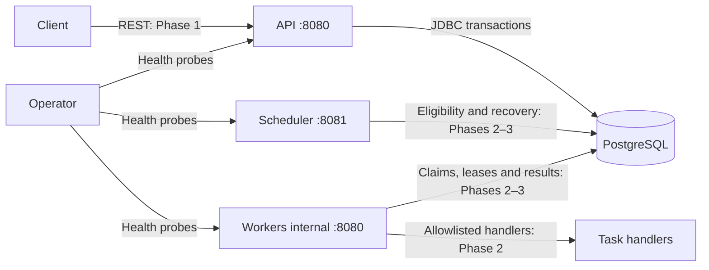

# Architecture

## Scope and context

DurableFlow will accept versioned DAG workflow definitions and execution requests, persist state, coordinate eligible tasks across workers, and recover abandoned work. PostgreSQL is the initial source of truth and coordination point. Clients communicate through a REST control plane. Task execution will be at least once.

Phases 0–2 implement startup, migrations, health, domain state machines, the control plane, atomic claims and distributed execution. Lease recovery and session-advisory-lock scheduler leadership are implemented in Phase 3.

## Components

- **Model:** dependency-free domain types, DAG rules and explicit state machines (Phase 1).
- **API:** validation, idempotent submission, queries and cancellation; durable commit before acknowledgement.
- **Persistence:** JDBC operations, schema and Flyway migrations. Transactional state changes belong here; transaction scopes must be visible at call sites.
- **Scheduler:** dependency eligibility and terminal propagation, then lease recovery and leader maintenance.
- **Worker:** capability registration, atomic task claims, bounded handler execution, heartbeat and result reporting. Task code runs outside database transactions.
- **Integration tests:** real PostgreSQL behavior and application startup verification.

Phase 1 adds versioned definitions, executions, tasks and dependency tables. Scheduler and worker loops are implemented in Phase 2. The initial `engine_metadata` table verifies migrations without guessing later domain schemas.

## Initial deployment topology

Compose runs one API, one scheduler, three workers and PostgreSQL 17 with a named persistent volume. Application images run as an unprivileged user. All host ports bind to loopback. Internally each application listens on port 8080; host ports distinguish processes. Flyway runs on each application's startup; Flyway serializes migration application using its database locking mechanism. An application cannot become ready until migration succeeds. A migration failure prevents startup.

All applications share the persistence resource and use a maximum of five JDBC pool connections each (25 potential application connections in this topology). PostgreSQL sessions use UTC and schema timestamps use `TIMESTAMPTZ`. Identifiers for later domain tables will use UUIDs; the bootstrap singleton marker is not a domain identifier.

## Trust boundaries

Clients are untrusted and will only access the API. Input validation and limits arrive with the API, with authentication/authorization hardening in Phase 4. Workers and scheduler are trusted services on the internal network and initially have direct database access. A compromised service database credential can compromise engine state; separate database roles and migration credentials remain future hardening work. Compose supplies credentials from ignored local environment configuration. PostgreSQL storage is persistent but is not backed up by Compose.

Health endpoints reveal aggregate status only. Logs use ECS JSON; workflow/task/attempt/worker/trace fields will be added when those entities exist. There are no control-plane routes to secure yet. Do not expose this development deployment publicly. Untrusted payloads will never select arbitrary executables, scripts or classes.

## Coordination and delivery design

Use short PostgreSQL transactions with row locks/atomic updates for task claims. Leases will identify the owning worker and attempt, with database-time expiration. Guard every completion against stale ownership; no worker may extend its authority using only in-memory state. A later recovery loop will retry expired work. A scheduler advisory lock will coordinate periodic maintenance only; task-claim correctness must not rely on leader availability.

Intended workflow states: `PENDING`, `RUNNING`, `SUCCEEDED`, `FAILED`, `CANCELLING`, `CANCELLED`. Task states: `BLOCKED`, `READY`, `LEASED`, `RUNNING`, `RETRY_WAIT`, `SUCCEEDED`, `FAILED`, `DEAD_LETTERED`, `CANCELLED`. Transition matrices and exhaustive rejection tests are implemented in the domain module.

A worker can perform a side effect and crash before committing success. Recovery can repeat that effect. Handlers must use a stable task idempotency key across attempts with the external system or record the effect transactionally when possible. No exactly-once guarantee is made.

## Expected failure modes

| Failure | Phase 0 behavior / later plan |
| --- | --- |
| PostgreSQL unavailable at startup | Flyway cannot initialize; process startup fails |
| Database disappears after startup | Readiness fails; liveness stays independent of database; workflow recovery later |
| Invalid migration or checksum drift | Startup fails; never auto-baseline or clean the database |
| Concurrent application startup | Flyway serializes schema migration; integration tests verify repeat application |
| Application exits | No durable execution state exists yet; Compose can be restarted manually |
| Worker dies or continues after lease loss | Future fenced result updates and lease recovery; duplicate effects remain possible |
| Scheduler dies | Future standby leadership acquisition and transactional rollback |
| Database volume lost | Data loss; backup/restore and high availability are outside this initial deployment |
| Graceful shutdown | Boot stops HTTP serving with a shutdown grace period; handler draining arrives in Phase 2 |

## Explicit non-goals

The engine executes workflows; automatic crash recovery is implemented; deployment HA remains outside the initial scope. Initial scope excludes exactly-once external effects, arbitrary code execution, general-purpose scripting, multi-region coordination, Kafka, Redis, Kubernetes, Raft, production deployment and managed cloud infrastructure. No throughput or latency target is claimed before executable measurements.

See [ADRs](docs/adr/README.md) for tradeoffs and [verification](docs/VERIFICATION.md) for current evidence.

## Phase 1: control-plane transaction boundaries

Definition names identify a family. Publication locks the family's database row and assigns `MAX(version)+1`; published JSON snapshots are immutable. Execution submission and every task/dependency row commit in one transaction. A unique idempotency key serializes concurrent submissions through `INSERT ... ON CONFLICT`; the losing transaction reads the committed row and compares canonical PostgreSQL JSONB request values. Equivalent requests reuse the execution; different requests return 409. Object key order is irrelevant, array order remains significant. Keys currently have global scope and do not expire.

DAG validation uses iterative Kahn traversal, supports disconnected components, and rejects duplicates, missing references, self-edges, cycles, more than 1,000 tasks or 10,000 edges. Each task has an explicit static JSON input; an empty task input inherits workflow input. Dependency edges order execution and do not implicitly merge predecessor output. API responses use snake_case persisted field names; request DTOs use camelCase. Collection pagination uses bounded limit/offset and stable creation-time/UUID ordering.

Cancellation locks the workflow, transitions through CANCELLING, cancels outstanding tasks, and commits CANCELLED atomically. Repeated cancellation is idempotent. Already successful/failed workflows reject cancellation. Later worker-result updates must acquire the same workflow lock before touching tasks so a cancellation that commits first fences subsequent results.

## Phase 2: execution and reconciliation

Workers poll PostgreSQL directly. Claims first lock one eligible workflow with `FOR UPDATE SKIP LOCKED`, then one compatible READY task with the same clause. The workflow lock serializes brief state changes within a DAG; unrelated workflows can progress concurrently. Claims increment the attempt, persist LEASED ownership and expiration, then commit. A separate guarded update marks RUNNING and caps lease expiration at the execution timeout. Handler code runs after both transactions have ended. Heartbeats extend ownership only before expiration and never beyond the timeout.

Every start, result, reconciliation and cancellation takes the workflow lock before task locks. Completion additionally checks worker ID, attempt, lease expiration and row version. Heartbeats update a single task atomically without acquiring a workflow lock. This ordering prevents cancellation/result races and lock cycles. Execution is at least once; a lease cannot fence effects outside PostgreSQL.

Reconciliation changes BLOCKED tasks to READY only after every prerequisite succeeds. A permanent task failure fails the workflow and cancels **all** unfinished work (including independent branches); successful results remain available. This fail-fast policy avoids leaving work running after a workflow is known to have failed. The scheduler scans all active workflows for fairness, using one short transaction per workflow. Polling and this linear scan are deliberate initial throughput tradeoffs.

A worker has one execution slot, a unique UUID, an allowlisted capability set and an independent heartbeat thread. Shutdown stops acceptance, records DRAINING, waits up to ten seconds for current work, then interrupts and abandons it. A lease is left for recovery rather than claiming uncommitted completion. Compose grants a fifteen-second stop grace period and runs three worker replicas without host-published worker ports. Workers' health endpoints remain reachable inside the network.

Built-in handlers are pure transformations or bounded delay: `uppercase`, `sha256`, `delay` (0–30,000 ms), and `json-transform` (`pick`, `rename`, `count-keys`). There is no shell, scripting, dynamic class loading or outbound HTTP handler. A task's lease context supplies its stable task idempotency key for future side-effecting handlers.

## Phase 3: recovery and leadership

`task_attempts` durably records each claim, start and outcome. Completion deduplicates against the attempt's original worker and JSONB output before considering current workflow terminal status. Stale generations cannot overwrite newer results. Task updates also compare the selected version within the workflow transaction. Heartbeats remain single guarded statements and never resurrect an expired lease.

Only the PostgreSQL advisory-lock scheduler leader performs lease recovery and reconciliation. Expired attempts become RETRY_WAIT or DEAD_LETTERED according to category and remaining budget; available retries become READY in a later reconciliation. Manual retry has explicit domain guards distinct from normal terminal-state transitions. It grants another attempt budget without resetting historical attempt numbers. The leader holds one session connection and explicitly releases its advisory lock before returning that connection to Hikari.

See [delivery semantics](docs/DELIVERY_SEMANTICS.md) for all eight failure windows, transaction/duplicate-result behavior and the handler idempotency contract.
