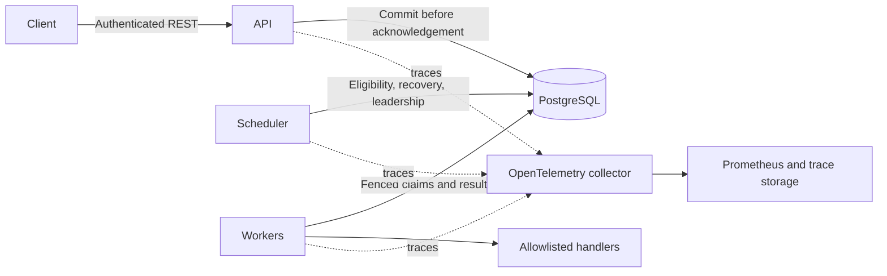

# DurableFlow

A small PostgreSQL-backed durable DAG workflow engine, built to make distributed execution and its failure modes understandable and testable.

**Status: Phases 0–6 implemented and verified locally; no release published.** Durable DAG execution and recovery include role-based API authentication, audit, strict input limits, OpenTelemetry traces, Prometheus metrics, executable failure tests, and exploratory 1/2/4/8-worker measurements. See the [Phase 5 report](docs/phases/phase-5.md), [release readiness report](docs/RELEASE_READINESS.md), and [benchmark results](BENCHMARKS.md). Benchmark numbers are a single local run, not production capacity claims.

Repository: `git@github.com:keechu32/DurableFlow.git`.

License: [MIT](LICENSE).

## Five-minute quick start

Requires Docker Desktop or another Docker Engine using Linux containers, Compose v2.24.4+, Python 3, about 4 GB available memory, and free loopback ports 5432, 8080–8081 and 9090. The Compose images provide Java 21 and Maven; no host JDK or Maven is needed to start the application. First-time image and Maven downloads may take longer than five minutes.

In Windows PowerShell:

```powershell
python scripts/init-env.py
docker compose up --build --wait --wait-timeout 240
Invoke-RestMethod http://localhost:8080/actuator/health
python durableflow-examples/run.py
```

The example publishes and executes a four-task diamond through the authenticated REST API, prints state changes and exits nonzero unless it reaches `SUCCEEDED`. It reads the local operator token from the ignored `.env`; the token is not printed.

On macOS/Linux, the same commands work with `python3` instead of `python`. Health probes are `/actuator/health`, `/actuator/health/liveness`, and `/actuator/health/readiness`; readiness includes database connectivity. API is at `localhost:8080`, scheduler health at `localhost:8081`, and worker health is internal on port 8080. PostgreSQL listens on `localhost:5432`. Published ports bind to loopback. Health details are hidden and sensitive actuator endpoints are not exposed.

Stop the stack without deleting persisted workflow data:

```powershell
docker compose down
```

`docker compose down --volumes` permanently deletes the local PostgreSQL and trace volumes; use it only when that data is disposable. Changing database credentials after the volume is initialized does not change existing PostgreSQL accounts.

## Build and verification

```powershell
mvn -B -ntp verify
mvn -B -ntp spotless:apply
```

Docker must be running for integration tests; they fail rather than silently skip when it is absent. CI uses ephemeral Testcontainers PostgreSQL, then builds and starts the complete Compose stack and probes every process. No manually provisioned database is needed.

If JDK 21 and Maven 3.9.9+ are not installed locally, run the suite in the repository's Java 21/Maven image from PowerShell:

```powershell
$workspace = (Get-Location).Path
docker run --rm `
  --mount "type=bind,source=$workspace,target=/workspace" `
  --mount "type=bind,source=/var/run/docker.sock,target=/var/run/docker.sock" `
  --workdir /workspace `
  --env TESTCONTAINERS_HOST_OVERRIDE=host.docker.internal `
  maven:3.9.16-eclipse-temurin-21 `
  mvn -B -ntp verify
```

For a host-only compile/test check without Docker, `mvn -B -ntp -DskipITs verify` is explicitly incomplete and does not prove PostgreSQL integration. See [verification evidence](docs/VERIFICATION.md) for actual results and limitations.

## Layout and design

| Module | Responsibility |
| --- | --- |
| `durableflow-model` | Dependency-free state machines and DAG validation |
| `durableflow-observability` | Shared trace SDK and bounded metrics |
| `durableflow-persistence` | Shared JDBC configuration and immutable Flyway migrations |
| `durableflow-api` | Public control-plane application |
| `durableflow-scheduler` | Coordination application |
| `durableflow-worker` | Execution application |
| `durableflow-integration-tests` | Cross-process foundation and PostgreSQL checks |

See [architecture](ARCHITECTURE.md), [ADRs](docs/adr/README.md), [phase checklist](docs/PHASE_CHECKLIST.md), and [contribution guide](CONTRIBUTING.md).



## Delivery semantics

The delivery contract is **at least once**: a task may run again after a crash or lease loss. Side-effecting handlers must use a stable task idempotency key with the destination system. PostgreSQL transactions cannot make arbitrary external effects exactly once.

Phases 0–5 deliver atomic claims and safe handlers, recovery and retries, telemetry and security, executable fault tests and exploratory measurements. Phase 6's documentation, templates, audits and fresh-clone simulation are complete; no release has been published. The API requires operator/admin bearer tokens; cancellation and manual retry require admin. Use this development deployment locally only.

Phase 5's exploratory measurements and their limitations are in [BENCHMARKS.md](BENCHMARKS.md); all successful and unsuccessful raw observations are retained under `benchmark/raw/` and `fault-tests/results/`.

Release preparation and known limitations are tracked in the [readiness report](docs/RELEASE_READINESS.md) and [release checklist](docs/RELEASE_CHECKLIST.md). No release has been published.

## Roadmap and known limitations

The implementation roadmap through Phase 6 is in the [phase checklist](docs/PHASE_CHECKLIST.md). This prototype has a single PostgreSQL source of truth and no database HA, backups, point-in-time recovery, multi-tenant identity, per-tenant quotas, or retention policy. Its shared development tokens and local plaintext network are not a production identity or transport design. Built-in handlers are safe demonstrations; external side effects require caller-provided idempotency and are not benchmarked. Potential production-hardening work is unscheduled and is not a release commitment.

## Troubleshooting

- Docker unavailable: install/start a compatible container runtime before `verify` or Compose startup.
- Port occupied: stop the conflicting service or change the host port in Compose and the smoke script.
- Database authentication fails: use the credentials that initialized the volume; reset it only if its data is disposable.
- Flyway validation fails: do not edit applied migrations; add a new versioned migration.
- Maven download fails: check access to Maven Central and your proxy configuration; do not disable TLS verification.
- An application is unhealthy: run `docker compose ps` and `docker compose logs api scheduler worker postgres`. Startup may take longer on the first image build.

## Control-plane example

The terminal demo above is the shortest end-to-end example. To make the REST requests explicitly in PowerShell, load the token only into a local process variable:

```powershell
$token = (Get-Content .secrets/operator-token -Raw).Trim()
$headers = @{ Authorization = "Bearer $token" }
$definitionBody = Get-Content durableflow-examples/diamond.json -Raw
$definition = Invoke-RestMethod `
  -Method Post `
  -Uri http://localhost:8080/api/v1/workflow-definitions `
  -Headers $headers `
  -ContentType 'application/json' `
  -Body $definitionBody

$executionBody = @{
  definitionId = $definition.definition_id
  version = $definition.version
  idempotencyKey = [guid]::NewGuid().ToString()
  input = @{}
} | ConvertTo-Json -Depth 10
$execution = Invoke-RestMethod `
  -Method Post `
  -Uri http://localhost:8080/api/v1/workflow-executions `
  -Headers $headers `
  -ContentType 'application/json' `
  -Body $executionBody
Invoke-RestMethod `
  -Uri "http://localhost:8080/api/v1/workflow-executions/$($execution.id)" `
  -Headers $headers
```

Definitions with the same name publish a new immutable version. Repeating an equivalent submission reuses the execution; conflicting key reuse returns 409. Query `/api/v1/workflow-executions/{id}` and `/api/v1/workflow-executions/{id}/tasks?limit=50&offset=0`. Cancel via `POST /api/v1/workflow-executions/{id}/cancel`. Errors use `application/problem+json` with a stable `code` field. Input bounds and semantics are described in ARCHITECTURE.md.

## Execute a DAG

```powershell
python durableflow-examples/run.py
docker compose logs -f worker scheduler
```

Compose starts three worker replicas. Scale with `docker compose up -d --scale worker=4`. Workers do not publish host ports. Inspect health with `docker compose ps` or `docker compose exec --index 1 worker curl --fail http://localhost:8080/actuator/health/readiness`. A permanent failure cancels all unfinished work; cancellation fences later results but cannot undo an already performed effect. Unknown task types remain queued until a compatible worker exists. See ARCHITECTURE.md for transaction and shutdown boundaries.

## Recovery and dead letters

The scheduler recovers expired leases automatically. Kill a worker during a `delay` task and another worker will claim a new attempt after lease expiry/backoff. The reproducible isolated failure demo uses the same owner-targeted injection:

```powershell
python scripts/init-env.py
docker compose build
python fault-tests/run.py --scenario worker-kill
```

It kills the actual owner of a running task, verifies the replacement attempt succeeds and records stale-owner fencing in a unique results directory. It does not touch the ordinary demo stack or data. Run `python fault-tests/run.py` to execute all nine scenarios. The full fault-tool contract and available single-scenario names are documented in [fault-tests/README.md](fault-tests/README.md).

Query `GET /api/v1/dead-letter-tasks?limit=50&offset=0`; retry with `POST /api/v1/task-executions/{id}/retry`. Retries preserve task identity and immutable input. A user-cancelled workflow cannot be reopened. See [delivery semantics and failure windows](docs/DELIVERY_SEMANTICS.md) before writing side-effecting handlers.

## Operations and security

Prometheus: http://localhost:9090. OpenAPI and API metrics require a bearer token. `scripts/init-env.py` creates distinct operator/admin tokens and the Prometheus secret file without printing them. The Python example reads the local operator token automatically. See [operations](docs/OPERATIONS.md) for metrics, trace inspection and dashboards, and [security/threat model](docs/SECURITY.md) for trust boundaries and remaining deployment requirements.
